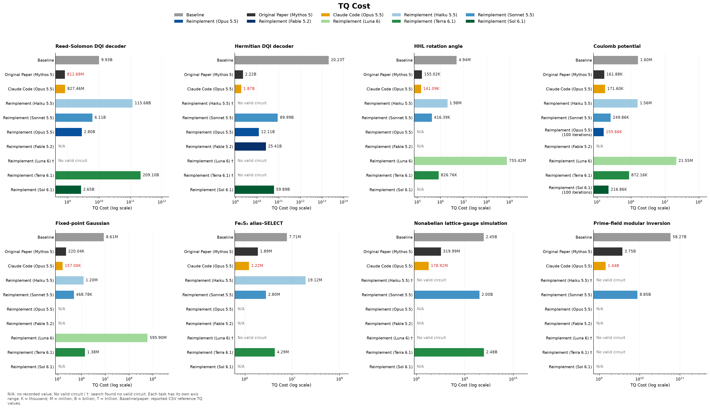

# Quantum circuit discovery reproduction

## Overview

This project reproduces circuit evaluation and reconstructs the LLM-driven search described in [Gu et al., *Discovering state-of-the-art quantum circuits with large language models*](https://arxiv.org/html/2610.22367v1).

It covers eight tasks spanning quantum optimization, numerical functions, quantum chemistry, lattice-gauge simulation, and elliptic-curve arithmetic. The objective is to minimize **TQ cost**: the product of the Toffoli-equivalent gate count **T** and peak logical qubit count **Q**, subject to each task's correctness requirements.

The implementation reuses the authors' circuit library and evaluator through a pinned [andigu/uncompute](https://github.com/andigu/uncompute) submodule, connects them to **OpenEvolve 0.4.1**, and adds Docker isolation, result comparison, experiment analysis, and independent integer checks of divstep branch recovery. Models propose algorithm families and evolve candidate programs from empty initial templates.

## Reproduction results

**Published circuit evaluation:** All eight published discovered circuits and five baseline circuits passed evaluation under the authors' conditions. Their T, Q, TQ, and generated op-stream SHA-256 matched the published records exactly. See the [evaluation records](reports/README.md).

**Reconstructed search:** Across 39 recorded experiments, 29 produced valid circuits. Sonnet 5.5 found valid circuits for all eight tasks in 20 iterations. On Coulomb potential, Opus 5.5 reached **TQ = 155,664** after 100 iterations, improving on the paper's **161,880** by approximately **3.84%**. The best reconstructed-search results on the other seven tasks remained above the paper's TQ.



Lower TQ is better. Each task uses its own logarithmic axis range. Gray bars show baselines, dark gray the original paper, orange direct Claude Code runs, and blue/green the reconstructed search. `No valid circuit` / `†` marks an unsuccessful search; `N/A` marks unavailable results.

Claude Code improved on the paper in six tasks, but its starting circuits, continuation instructions, and search budgets differed from the OpenEvolve experiments. The reconstructed search also uses different models and prompts from the original paper. These results do not establish identical discovery behavior or search efficiency.

See the [experiment report](docs/experiment_report.md) for task-by-task comparisons, validation criteria, limitations, failure analysis, API costs, and elapsed times.

## Running the implementation

Requirements: **Python 3.12–3.13**, [uv](https://docs.astral.sh/uv/), Git, and a running Docker daemon. Run the following commands from the repository root.

**1. Install dependencies and prepare the evaluator.**

```sh
uv sync --locked --extra openevolve
uv run --locked qdiscover upstream-setup
uv run --locked qdiscover docker-build
```

The setup fetches the pinned author implementation and applies the local serializer patch. Docker isolates generated code and validation from host credentials and networking. Rebuild the image after changing the code.

**2. Reevaluate the published circuits.** No LLM API key is required.

```sh
# Discovered and baseline circuits for the three numerical tasks
uv run --locked qdiscover reproduce --tasks numerical --kernel c

# Discovered circuits for all eight tasks; large tasks require more time and memory
uv run --locked qdiscover reproduce --tasks all --variant discovered --kernel c --jobs 2
```

Results are saved under `runs/reproduction/`. A circuit is marked `REPRODUCED` when evaluation passes and its resource counts and op-stream hash match the published record.

**3. Run an LLM-driven search.** Set the provider's API key in the environment or in `.env` in the current directory.

```sh
# ANTHROPIC_API_KEY: defaults to Claude Opus 5.5
uv run --locked --extra openevolve qdiscover openevolve coulomb-potential --iterations 20

# OPENAI_API_KEY: defaults to GPT-6.1 Sol
uv run --locked --extra openevolve qdiscover openevolve coulomb-potential \
  --backend openai --iterations 20 --out runs/coulomb-potential-gpt61sol
```

Use `--model` to select another model and `qdiscover openevolve --help` for available options. To resume, rerun the same command and output directory with `--resume`; `--iterations` specifies additional iterations. All other settings and the task specification must match. Use `--checkpoint PATH` to select a specific checkpoint.

See the [Docker guide](docs/docker.md) for execution limits and local execution.


Licensed under [Apache-2.0](LICENSE); see [NOTICE](NOTICE) for attribution.
