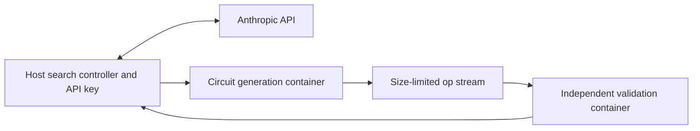

# Isolating generated code with Docker

`evaluate`, `reproduce`, and `openevolve` use Docker by default.
Only the search controller on the host has API connectivity and credentials.
Circuit generation and output validation run in independent containers.



## Setup and execution

Start Docker Desktop or a local Docker Engine.

```sh
uv sync --locked --extra openevolve
uv run --locked qdiscover docker-build

# Smoke test without API calls
uv run --locked --extra openevolve qdiscover openevolve toy-gf-inverse \
  --smoke-test --iterations 2 --islands 2 --out runs/docker-smoke

# Search with a real model
export ANTHROPIC_API_KEY="your-api-key"
uv run --locked --extra openevolve qdiscover openevolve coulomb-potential --iterations 100
```

The default model is Claude Opus 5.5 (`claude-opus-5-5`).
`docker-build` requires no key and builds the locked dependencies and public C kernel into the image.
Containers do not download dependencies during execution.
`.dockerignore` restricts build inputs to sources, lockfiles, and related files, excluding `.env`, `.aws`, `.ssh`, Git history, and local environments.

The source SHA-256 is stored in an image label and checked against the current code before execution.
Rebuild the image with `docker-build` after updating the code.
Execution stops if Docker or the image is unavailable, or if the image is outdated. It does not automatically fall back to local execution.
The image ID and applied limits are saved under `sandbox` in each `evaluation.json`.

## Isolation boundaries

| Resource | Implementation |
|---|---|
| API keys and other host environment variables | Not forwarded to candidate containers |
| Docker client proxy settings | Uppercase and lowercase proxy variables overridden with empty values |
| Networking | `--network=none` for both generation and validation |
| User and privileges | UID/GID 65532, all capabilities dropped, privilege escalation disabled |
| Filesystem | Read-only root; size-limited tmpfs workspace |
| Host sharing | One input file mounted read-only; no writable host mounts |
| Docker socket and home directory | Not mounted in candidate or validator containers |
| CPU, memory, and processes | Limits applied per container |
| Logs and circuit output | Logs limited to 4 MiB; op streams default to 1 GiB; exceeding limits stops execution |
| Time limits | Host deadline and in-container `timeout`; forced cleanup on termination |
| Validation | Authors' grader runs in a fresh container, without changes made by the candidate process |

Generated code writes its circuit to a temporary file inside the container, and the controller receives it subject to a size limit.
Only these bytes are passed to the validator; Python objects from the candidate and in-process judgments are not used.
Validation reports are also returned through size-limited standard output.
Neither container receives writable access to the host directory containing experiment results.

These controls use [Docker security mechanisms](https://docs.docker.com/engine/security/) and [runtime options](https://docs.docker.com/engine/containers/run/).
Containers depend on host-kernel isolation, so Docker itself also needs to be maintained and updated.

## Adjusting limits

```sh
uv run --locked --extra openevolve qdiscover openevolve dqi-hermitian \
  --sandbox-cpus 4 --sandbox-memory-mb 8192 --sandbox-pids 256 \
  --sandbox-tmp-mb 2048 --sandbox-max-ops-mb 2048 --timeout 1800
```

| Option | Default |
|---|---:|
| `--sandbox-cpus` | 2 |
| `--sandbox-memory-mb` | 4096 |
| `--sandbox-pids` | 256 |
| `--sandbox-tmp-mb` | 1024 |
| `--sandbox-max-ops-mb` | 1024 |

The combined memory-plus-swap limit equals the memory limit, preventing additional swap usage.
Limits apply per container. Account for aggregate resource use when increasing `--workers`.
`--jobs` controls parallel evaluation within a validation container.
Timeouts, out-of-memory errors, output-limit violations, and invalid circuits are recorded as failures.

External candidate code should be a self-contained file and access required task constants and data through `QDISCOVER_TASK_DIR`.
Adjacent host files are not shared implicitly.
Reevaluation of the authors' published circuits uses the same pinned sources, constants, and helper modules in the image.

## Running trusted code locally

```sh
uv run --locked qdiscover kernel
uv run --locked qdiscover reproduce --tasks numerical --execution local
```

`--execution local` does not isolate code from host files or networking. Use it only for reviewed programs.
Child-process environments still use an allowlist and do not inherit API keys or similar credentials.
Use the default Docker execution mode for automated searches over generated code.

## Validation

```sh
uv run --locked qdiscover docker-build
QDISCOVER_REQUIRE_DOCKER=1 uv run --locked --extra openevolve pytest -m docker
```

Tests use real containers to check credential isolation, disabled networking, rejected source writes, capability and resource limits, cleanup after deadlines, and resistance to forged validation results.
They also check agreement with published hashes, Toffoli counts, and qubit counts for the six numerical discovered/baseline circuits.
Both OpenEvolve and the custom search implementation are exercised through candidate replay without API calls.
`QDISCOVER_REQUIRE_DOCKER=1` makes tests fail rather than skip when Docker is unavailable.
