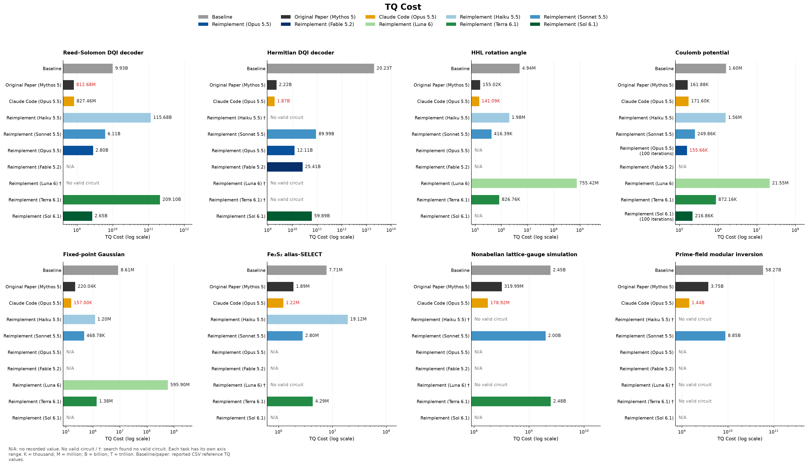
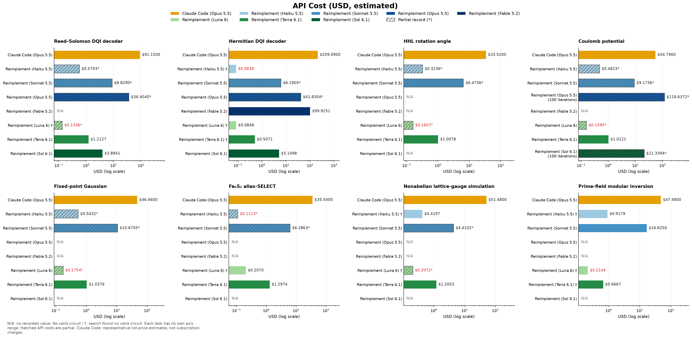
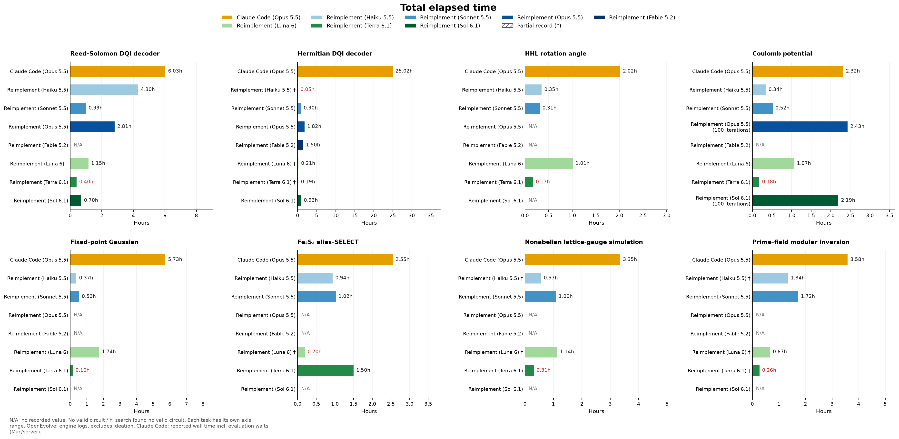

# Reproducing LLM-based quantum circuit search: implementation and results

This project reconstructs a quantum circuit search agent using OpenEvolve, based on the public code accompanying Gu et al., [Discovering state-of-the-art quantum circuits with large language models](https://arxiv.org/html/2610.22367v1).
This report compares multiple Anthropic and OpenAI LLMs on the paper's eight tasks. It also evaluates direct use of Claude Code as an alternative to the OpenEvolve-based agent system used in the paper.

## 1. Problem setting

The circuit-design problem is to implement computations used within quantum algorithms with fewer gates and qubits. Tasks include decoding error-correcting codes, evaluating numerical functions, simulating quantum chemistry and lattice-gauge systems, and computing inverses over prime fields. These operations must preserve quantum superpositions, so intermediate information cannot simply be overwritten or discarded as in ordinary programs. Information left in workspace qubits must also be erased through uncomputation.

The search objective is to minimize the product $TQ$ of the Toffoli count $T$ and peak qubit count $Q$, while satisfying each task's input/output, phase, and ancilla requirements, including allowed approximation errors and failure rates. Gate count and workspace can trade off, so candidates are compared using their combined resource cost.

In the paper's search method, an LLM proposes Python code that generates a circuit, an independent evaluator checks correctness and resources, and the results feed into the next improvement. The aim includes algorithm-level changes to computation order, data representation, and information erasure, beyond local gate substitutions in a fixed circuit.

### 1.1 The kickmix circuit model and evaluation

The circuits follow the **kickmix** model, combining classical reversible logic gates, uncomputation through X-basis measurements, and diagonal phase gates. For example, NOT, CNOT, and Toffoli compute values, while Z, CZ, and CCZ change phase. The model is defined in [Appendix A.4 of Babbush et al.](https://arxiv.org/html/2603.28846#A4).

Measurement-based uncomputation measures ancillas holding temporary values in the X basis and applies phase corrections conditioned on the outcomes. Correcting the measurement's phase effect on the data can reduce the gates needed for reverse computation. Correct output bits alone are therefore insufficient; phase and ancilla cleanup must also be evaluated.

In kickmix, each trial with a selected computational-basis input and measurement outcomes can be tracked using bit strings and a sign. Avoiding full-amplitude simulation of general quantum states enables classical evaluation of large candidate circuits and supports testing many LLM proposals. The evaluator checks output, phase, and ancilla requirements while measuring Toffoli-equivalent counts and peak qubits. Exact simulation of each selected trajectory, however, is distinct from proving correctness for all inputs using finitely many trials.

### 1.2 The eight tasks

The table summarizes each task's computation. All searches seek circuits that preserve input superpositions and satisfy the specified output, phase, and ancilla conditions. Task names follow Table 1 of the paper.

| Task | Application | Computation |
|---|---|---|
| Reed–Solomon DQI decoder | Quantum optimization using decoding (DQI) | Apply the prescribed phase based on error information determined by 70 syndrome values, preserving the input syndromes. |
| Hermitian DQI decoder | DQI optimization using Hermitian codes | Apply the prescribed phase based on error information determined by 123 syndrome values, preserving the input syndromes. |
| HHL rotation angle | Rotation-angle computation for quantum linear-system algorithms | Compute a fixed-point inverse-sine value determined by the input and add it to the output register. |
| Coulomb potential | Coulomb interaction between particles | Approximate the reciprocal distance between two points and add it to the output register. |
| Fixed-point Gaussian | Fixed-point numerical function evaluation | Approximate the Gaussian function $e^{-x^2}$ for input $x$ and add it to the output register. |
| Fe₂S₂ alias–Select | Quantum chemistry Hamiltonian simulation | Select a term using an alias table, apply the corresponding signed Pauli operation, and erase temporary selection information. |
| Nonabelian lattice-gauge simulation | Nonabelian lattice-gauge theory simulation | Compute a product around a loop from group elements on lattice links, and add a value based on the trace of its representation matrix. |
| Prime-field modular inversion | Reversible elliptic-curve arithmetic | Implement secp256k1 point addition. Prime-field inversion for slope calculation is the main design target, but the benchmark evaluates complete point addition rather than inversion alone. |

### 1.3 Information supplied in prompts

Reimplement supplies the following shared information during initial ideation and code generation at each iteration.

| Information | Prompt contents |
|---|---|
| Task specification and input/output requirements | Task name, constants and register layout from `contract.json`, and task-specific specification text, including the target function, preserved inputs, phase, ancillas, approximation bounds, and failure rates. |
| Circuit model and evaluation rules | kickmix constraints; CCX/CCZ counting as Toffoli; TQ minimization; checks for outputs, input preservation, phase, clean ancillas, and duplicate gate arguments. |
| Circuit generation API | `uncompute.Builder` API implementation and short examples covering register declarations, gates, measurements, phase corrections, reuse, and circuit output through `b.emit()`. Controls for classical input Bit values and measurement Outcome values are distinguished. |
| Classical reference functions | Public function names, arguments, and docstrings from `reference.py`, plus the invocation format of `qdiscover oracle`. Reference function bodies are not pasted into prompts. |
| Implementation constraints | Do not inspect quantum inputs with ordinary Python branching, read published discovered/baseline circuits, or modify the evaluator, grader, or contract. |

Initial ideation adds an instruction to propose five distinct algorithm families and return their names and descriptions as JSON only, without code. The resulting approaches are assigned to islands.

During search, the shared information and assigned algorithm family are included in the system message, with an instruction to design a correct reversible circuit minimizing TQ and return a short explanation plus complete Python code. OpenEvolve's user message includes current candidate code and scores, past attempts or reference candidates, and evaluator judgments, errors, reports, and standard-error logs. The first implementation starts from an empty template; later iterations improve saved candidates using evaluation results.

## 2. Implementation and experimental conditions

### 2.1 Reevaluating public circuits and reconstructing search

The authors' implementation is pinned to commit `64b5a13aa249f1360846657392e6c66817b26d0f`. Existing circuits, arithmetic gadgets, the circuit generation API, and the evaluator are reused from the authors' code. This repository implements generation/evaluation control, result comparison, and search integration. It does not independently rewrite the entire arithmetic circuit library.

Published circuits are regenerated from Python code and checked with the authors' task constants, test distributions, trial counts, and failure budgets. Validation checks outputs, preserved inputs, phase, clean ancillas, and duplicate gate arguments. A result is marked `REPRODUCED` only when evaluation passes and T, Q, TQ, and the generated raw op-stream SHA-256 match the published record. Diagnostic runs with `--shots` do not count as reproduced results.

The original search prompts, complete history, random settings, and model sessions are unavailable. Complete coefficient/schedule searches and Lean builds were not rerun. Circuit reevaluation and reconstruction of the search infrastructure are therefore distinct reproduction goals.

Reimplement uses OpenEvolve 0.4.1. It proposes multiple algorithm families from task specifications and the shared API, then iterates over complete candidate programs, circuit evaluation, and candidate sharing, starting from empty programs. MAP-Elites features are Toffoli and qubit counts, and valid candidates receive a score of `1 / (1 + TQ)` to minimize TQ. Published discovered and baseline circuits are not used as initial solutions.

All LLMs use `reasoning_effort="high"` and an output limit of 128,000 tokens. OpenEvolve uses five islands and 20 iterations, except for Coulomb experiments with Claude Opus 5.5 and GPT 6.1 Sol, which use 100 iterations.

## 3. Metrics and chart interpretation

TQ is the product of the authors' Toffoli-equivalent count T, including their counting rules for Toffoli, CCZ, and related operations, and the peak number Q of simultaneously live logical qubits. Lower values indicate better resource efficiency. TQ does not directly measure physical qubits, error-correction overhead, circuit depth, or hardware runtime.

Circuit validity checks include output, required input preservation, phase, and clean ancillas. The three numerical tasks must meet specified approximation bounds. DQI permits up to 100 failures in 100,000 trials; point addition permits 20 in 100,000. VALID therefore does not constitute a proof of exact correctness for all inputs.

Chart symbols mean:

- `No valid circuit` / `†`: The search completed without obtaining a valid circuit.
- `N/A`: Not executed, not recorded, or not yet determined.
- Hatching and a trailing `*`: Only part of the cost or time was recorded. Parentheses in series names identify models and are unrelated to this symbol.
- Red text: The observed minimum for each task and metric. Low costs/times from failed searches are included, so red text alone does not indicate successful search efficiency.

Figures 1–3 place the eight tasks in four columns and two rows, read left to right and top to bottom. TQ and API cost use logarithmic axes with task-specific ranges. Read numeric labels rather than directly comparing bar lengths across panels. K, M, B, and T denote thousand, million, billion, and trillion.

## 4. Circuit resource comparison

Figure 1. TQ comparison. Gray denotes the baseline, dark gray the original paper, orange Claude Code, and blue/green shades Reimplement.

### 4.1 Best result per task

Each Reimplement best result is selected from valid circuits produced by the models run on that task. These are post hoc best values across models, not results from one model on all eight tasks. Each paper ratio divides TQ by the paper's reference TQ; values below 1 indicate improvement. Both ratio columns use blue for values at or below 1.0 and red for values above 1.0.

| Task | Paper TQ | Reimplement best (model) | Ratio to paper | Claude Code TQ | Ratio to paper |
|---|---:|---:|---:|---:|---:|
| DQI Reed–Solomon | 812,683,289 | 2,653,246,832 (Sol) | 3.265 | 827,456,062 | 1.018 |
| DQI Hermitian | 2,219,954,240 | 12,113,096,022 (Opus) | 5.456 | 1,868,779,135 | 0.842 |
| HHL angle | 155,020 | 416,392 (Sonnet) | 2.686 | 141,086 | 0.910 |
| Coulomb | 161,880 | 155,664 (Opus) | <strong>0.962</strong> | 171,597 | 1.060 |
| Gaussian | 220,037 | 468,780 (Sonnet) | 2.130 | 157,002 | 0.714 |
| Fe₂S₂ chemistry | 1,887,228 | 2,796,120 (Sonnet) | 1.482 | 1,224,537 | 0.649 |
| Lattice gauge | 319,985,952 | 2,003,721,984 (Sonnet) | 6.262 | 178,919,496 | 0.559 |
| Modular-inversion point addition | 3,746,239,255 | 8,851,812,864 (Sonnet) | 2.363 | 1,440,264,640 | 0.384 |

Reimplement's best results improved on the baseline for every task, but improved on the original paper for only one task. Reasoning depth is a possible factor: most experiments were limited to 20 OpenEvolve iterations, whereas the result that beat the paper used the frontier model Opus 5.5 for 100 iterations.

Claude Code improved on the original paper in six tasks. This shows that a single agent reached high-quality circuits under these conditions, but does not separate the effects of starting from baselines, continuation stages, human instructions, and search budgets.

### 4.2 Results by model

| Reimplement model | Recorded experiments | Experiments with valid TQ |
|---|---:|---:|
| Haiku 5.5 | 8 | 5 |
| Sonnet 5.5 | 8 | 8 |
| Opus 5.5 | 3 | 3 |
| Fable 5.2 | 1 | 1 |
| Luna 6 | 8 | 3 |
| Terra 6.1 | 8 | 6 |
| Sol 6.1 | 3 | 3 |
| Total | 39 | 29 |

Sonnet, Opus, and Sol generated valid circuits for every task they attempted. The lighter Haiku and Luna models failed to obtain valid circuits on some tasks. Under these conditions, stronger and lighter models differed in their ability to implement circuits satisfying the task specifications.

Both the paper and this reproduction use the authors' custom circuit generation library `uncompute`, rather than a general-purpose quantum library or an official kickmix library. Its API and examples are supplied to the LLM through prompts. Models must therefore understand and correctly use the custom API and its constraints, in addition to designing the circuit.

### 4.3 Why some experiments produced no valid circuit

Saved logs were examined for seven of the ten experiments marked `No valid circuit` in Figure 1. Failures occurred at several stages: generating executable code, meeting required input/output layouts, and implementing correct circuit behavior/phase. They were not rejected for having excessive TQ.

| Task and model | Failure category and reason |
|---|---|
| Reed–Solomon DQI decoder, Luna 6 | • **Code generation:** Out-of-range array accesses and syntax errors prevented circuit generation. • **Input/output layout:** Registered 840 bits as one register instead of the required 70 registers of 12 bits. • **Function/phase:** Approximately half of the trials had incorrect phase for the six candidates reaching evaluation. |
| Hermitian DQI decoder, Haiku 5.5 | • **Code generation:** The decoder was unimplemented, ending with `NotImplementedError`. • **Function/phase:** Approximately half of the trials had incorrect phase for the eight candidates reaching evaluation. |
| Hermitian DQI decoder, Luna 6 | • **Code generation:** Out-of-range array accesses prevented circuit generation. • **Input/output layout:** Register counts were incorrect in 14 candidates, for example one register instead of the required 123. • **Function/phase:** Both candidates reaching evaluation had incorrect phase in 50,065 of 100,000 trials. |
| Hermitian DQI decoder, Terra 6.1 | • **Code generation:** Returned prose explaining implementation difficulty instead of code, causing syntax errors. • **Function/phase:** The one executable candidate had incorrect phase in 49,809 of 100,000 trials. |
| Fe₂S₂ alias–Select, Luna 6 | • **Code generation:** All 20 candidates terminated with exceptions while parsing Pauli masks and alias tables. |
| Nonabelian lattice-gauge simulation, Haiku 5.5 | • **Code generation:** All 20 candidates failed due to nonexistent file references, type confusion, misuse of reference calculations, or similar errors. |
| Prime-field modular inversion, Haiku 5.5 | • **Code generation:** Many candidates failed during circuit generation. • **Function/phase:** The one candidate reaching evaluation produced incorrect outputs in all 100,000 trials. |

### 4.4 Generation truncated by output limits

The Fable 5.2 Hermitian DQI decoder experiment used `max_tokens=128000` and `effort=high`, but 14 of 21 requests, including initial ideation, reached the output limit. Logs showed that all 128,000 tokens were used for reasoning. Because the limit covers both reasoning and answers, even the maximum setting can be exhausted by reasoning before code is completed. Lowering effort is one possible response, but was not compared here.

Truncated iterations count as generation failures. Incomplete code is not evaluated, but its API cost is included. Fable eventually produced a valid circuit, although 14 of the 20 iterations did not reach code evaluation.

## 5. API cost and elapsed time

Figure 2. Estimated API cost in USD. Hatched Reimplement values use partial records. Claude Code values are reported list-price estimates, not actual subscription charges.

Figure 3. Elapsed time. Reimplement values are reconstructed from engine logs and final reevaluation and exclude initial ideation. Claude Code values are conversation wall times including evaluation waits and excluding the initial baseline evaluation.

Initial ideation sends the task specification and shared circuit API description to the LLM before search and asks for distinct algorithmic approaches. This setup prepares five approaches and assigns one to each search group (island).

## 6. Conclusions

The results show that evaluation of the published circuits can be reproduced and that the reconstructed search engine improves resource use on multiple tasks. Sonnet produced valid circuits for all eight tasks in 20 iterations, and Opus achieved smaller TQ on the three tasks it attempted. In particular, 100 iterations on Coulomb improved the paper's reference TQ by approximately 3.84%. On the other seven tasks, however, even Reimplement's best TQ remained above the paper's, so comparable discovery results were not reproduced across all tasks.

The Claude Code results show that iterating a single agent with an evaluator can reach TQ near or below the paper's under these conditions. Differences in models, starting circuits, search budgets, and human continuation instructions mean that further experiments are needed to assess the effectiveness of OpenEvolve itself.
